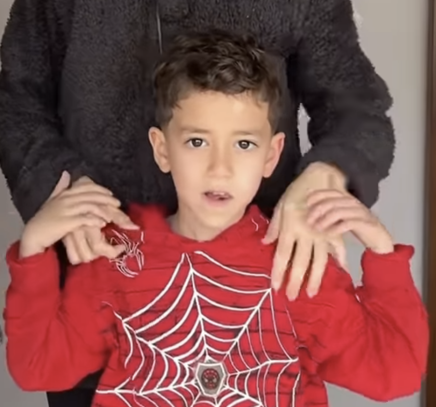

# Curiosity Lab

A family-supported space with example prompts for building, puzzles, and new
discoveries. The page uses sample content that can be replaced with projects
approved for sharing.



## Example ideas

- **Paper tower** — sketch a simple structure and explore what helps it stand.
- **Pattern puzzle** — find a repeating pattern and invent a new one.
- **Question hunt** — explore a question with a book or parent-approved activity.

These are generated examples, not claims about personal interests or finished
work. The site does not publish an age, school, precise location, or personal
contact and social-media details. A parent reviews what is shared.

## Family site

The family website is managed by [Khadija Chahmoud](https://khadijachahmoud.github.io/).

## Run locally

```bash
npm ci
npm run dev
```

Create a production build with `npm run build`.

The site shares its layout and basic accessibility features with the family
website while keeping its own example content and portrait.
